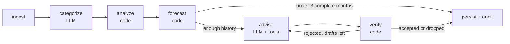
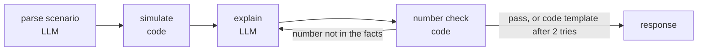
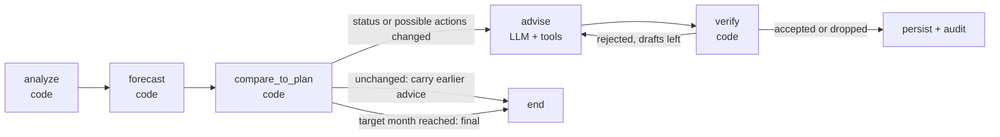

# FinPilot

FinPilot is a proactive financial agent. It ingests a bank CSV, categorizes each transaction with an LLM, detects recurring charges, anomalies and spending trends, forecasts the account balance with a range, simulates what-if decisions ("can I afford a $2,000 trip next month?"), and gives specific advice such as cancelling a membership you have stopped using. Before any recommendation is shown, a code-based Verifier recomputes every figure in it from the user's own transactions and the forecast engine, and rejects the draft if anything does not check out. Every LLM call goes through Mesh API. Built for Agent Arena 2026 (Track 02).

## Results at a glance

All on the synthetic development set (seed 42, 3 personas, 1,904 transactions), one run each, and the prompts and forecast method were revised after reading earlier results (see [Self-evaluation](#self-evaluation)). Nothing here is a held-out or real-data result.

| Measure | Result | Source |
|---|---|---|
| Categorization, strict accuracy (cat-v2, `openai/gpt-4o-mini`) | 95.3% (lenient 96.4%) | [categorization_cat-v2.md](eval/results/categorization_cat-v2.md) |
| Pattern detection recall (7 pattern types) | 100% on every type; all 4 controls pass | [patterns.md](eval/results/patterns.md) |
| Forecast MAPE, total next-month spend (fc-v2) | 11.2%, against 13.2% for "same as last month" and 11.4% for the 3-month mean | [forecast_fc-v2.md](eval/results/forecast_fc-v2.md) |
| Forecast 80% band coverage | 54.2% of actuals | [forecast_fc-v2.md](eval/results/forecast_fc-v2.md) |
| Advisor first-draft failure rate, adv-v1 baseline (rejected by the Verifier) | 68.4% (adv-v3, the active version: 33.3%) | [advice_adv-v1.md](eval/results/advice_adv-v1.md), [advice_adv-v3.md](eval/results/advice_adv-v3.md) |
| Goal tracking | two replayed scenarios and one controlled pair; mechanics, not accuracy | [goals.md](eval/results/goals.md) |

## Why it is not another dashboard

A dashboard reports what already happened. FinPilot has four forward-looking pieces and a record of how each answer was produced:

- **Forecast.** A deterministic month-by-month balance projection (expected value plus a p10-p90 band) built from active recurring charges, recent variable spend per category, recent income and a one-off allowance (the recent average of spend the Analyzer flagged as anomalies, leaving out anomalies that belong to a recurring series, since that series is already projected). No LLM is involved in the numbers.
- **What-if.** Free text ("What if I buy a $1,200 laptop in December?") is parsed into a structured scenario, added to the baseline forecast in code, and compared with the baseline. The verdict (`affordable`, `tight`, `not_affordable`) comes from a fixed rule on the projected balance, not from the model. The LLM only parses the question and words the explanation, and the explanation is number-checked.
- **Proactive recommendations.** A pipeline run produces advice the user did not ask for: cancel a membership whose parent merchant has had no spend for 90+ days, review a price rise, or look at a spending category that is rising. "Proactive" here means a run surfaces advice on its own; there is no background schedule (see [Not built](#not-built)).
- **Goal tracking.** Set a savings target and replay it month by month: each month's status (ahead, on track, behind) is computed in code from the forecast, and the Advisor is called again only when the situation changes (see [Goal tracking and replay](#goal-tracking-and-replay)).
- **Audit trail.** Every draft of every recommendation is stored with the Verifier's per-claim recomputation and per-rule results, including rejected drafts. `GET /api/recommendations/{id}/audit` returns the whole history.

## How the agents cooperate

The coordinator is a LangGraph `StateGraph` in [backend/graph.py](backend/graph.py). Agents are plain functions in [backend/agents/](backend/agents/); graph nodes are thin wrappers that call them, persist results and write `agent_events` rows (shown in the run timeline in the UI).

Main run (started per uploaded batch):



What-if (synchronous, `POST /api/simulate`):



Goal check (one per replayed month, see [Goal tracking and replay](#goal-tracking-and-replay)):



| Agent | Owns | LLM? |
|---|---|---|
| [Categorizer](backend/agents/categorizer.py) | One category per transaction from a closed 15-category list, with confidence and a short rationale. Batched, strict JSON schema re-validated in code (bad or missing items are retried, never defaulted), merchant cache. | Yes (`CATEGORIZER_MODEL`) |
| [Analyzer](backend/agents/analyzer.py) | Recurring monthly charges, price changes, possibly-unused memberships, anomalies (spike, duplicate, new large merchant) and category trends. Every pattern stores the transaction ids it is based on. | No |
| [Forecaster](backend/agents/forecaster.py) and [what-if](backend/agents/whatif.py) | The projection engine, scenario simulation and the affordability verdict are code. The LLM is used only to parse the scenario text (`PARSER_MODEL`) and to write the explanation (`ADVISOR_MODEL`). | Only for parsing and wording |
| [Advisor](backend/agents/advisor.py) | Drafts up to 5 recommendations using read-only tools (`list_patterns`, `get_pattern`, `get_forecast`, and `get_goal` in goal runs only) that hand it every figure as a ready-made claim. Allowed actions: `cancel`, `review_price_increase`, `reduce_spending`. | Yes (`ADVISOR_MODEL`) |
| [Goal tracker](backend/agents/goal_tracker.py) | Compares a savings goal with the month's forecast and sets the status (ahead, on_track, behind, achieved, missed); decides whether the Advisor needs to run again. Lifecycle (create, advance, reset, delete) is in [backend/goals.py](backend/goals.py). | No |
| [Verifier](backend/agents/verifier.py) | Checks each draft against the database and the forecast engine and returns pass or reject with structured reasons. | No |
| Coordinator ([graph.py](backend/graph.py)) | State, routing, the advise-verify loop, persistence, run and event logging. | No |

All LLM access goes through one module, [backend/llm/client.py](backend/llm/client.py): the OpenAI SDK pointed at `https://api.meshapi.ai/v1`, key from `MESH_API_KEY`, model per agent from environment variables.

## The loop and the audit trail

After the Advisor drafts recommendations, each draft goes to the Verifier. A rejected draft goes back to the Advisor together with the Verifier's structured failures (which check, what was claimed, what was recomputed, and, from adv-v2 onward, for each stray number the nearest valid claim). The Advisor may redraft or withdraw. A recommendation lineage gets at most 3 drafts; if the third is still rejected it is dropped and logged. Only accepted drafts are served, ranked by the Verifier-recomputed annual impact, one per trigger and action.

**What the Verifier checks** ([verifier.py](backend/agents/verifier.py)):

| Rule | What it does |
|---|---|
| schema | Action is one of the three allowed; claims are well formed (kind, unit, required month). |
| trigger | The cited pattern exists in this run, and a redraft keeps its lineage's trigger. |
| target | The target names the trigger's merchant or category. |
| action | The pattern supports the action: `cancel` only for an active, fixed-price, possibly-unused membership; `review_price_increase` only after a price rise; `reduce_spending` only for a rising trend whose latest month is above its prior 3-month mean. |
| required_claims | Each action carries its primary claims (for example `cancel` needs `recurring_cost` and `projected_balance_delta`). |
| claim recompute | Every claim is recomputed and compared with a tolerance of at most 1 cent (exact for sums and engine re-runs; a yearly figure scales the tolerance by 12). |
| numbers | Every money amount, percentage, month or date, and "N days/months" in the title and body must match one of the draft's claims. Other bare integers are ignored. |

**How claims are recomputed.** Recurring-charge and trend claims (cost, price change, excess spend, days since the parent merchant's last spend) are recomputed from the raw transactions, using the pattern's evidence ids and the stored category labels, not from the Analyzer's stored parameters, so an Analyzer bug would surface as a mismatch. Forecast claims (`forecast_balance`, `forecast_balance_p10`, `projected_balance_delta`) are recomputed by re-running the forecast engine over this run's stored forecast inputs; for the delta, with the action applied (cancel removes the recurring flow; reduce holds the trend flow flat at next month's level). That checks the arithmetic and the claim, but it does not re-derive the forecast inputs from raw transactions.

**What a rejection looks like.** These are real first-draft rejections from the committed adv-v3 run ([advice_adv-v3.md](eval/results/advice_adv-v3.md)):

| Draft | Failed check | Reason |
|---|---|---|
| cancel UBER*ONE MEMBERSHIP | numbers | `'288 days' in the text matches no claim` |
| reduce_spending food delivery | numbers | `'2026-09' in the text matches no claim` |
| review_price_increase SPOTIFY USA | numbers | `'$12' in the text matches no claim` |

All three were accepted after one redraft. In the adv-v1 run, one draft failed the action rule: `utilities is not rising above its recent level`, and the Advisor withdrew it on redraft ([advice_adv-v1.md](eval/results/advice_adv-v1.md)).

**What the audit endpoint returns.** `GET /api/recommendations/{id}/audit` returns the recommendation's lineage: run id, trigger (pattern title and its evidence transaction ids), the forecast id and `as_of` month used, the model and prompt version, and every attempt. Each attempt has its status, action, target, title, body, claims, verdict, reasons, per-claim `checks` (claim, recomputed value, tolerance, ok, note), per-rule `rule_checks`, and a timestamp. The run endpoint (`GET /api/runs/{id}`) lists the ordered `agent_events`, including each Verifier rejection and the redraft that followed.

## Goal tracking and replay

**The goal.** A profile can have one active goal: a name, a target amount, a `start_month` and a `target_month` (1 to 12 months after the start). The goal is to grow this account's balance by the target between the end of the start month and the end of the target month. "Saved" is that balance growth, computed from the transactions and the opening balance. The plan line is straight: $0 at the end of the start month, the full target at the end of the target month. A second goal on the same profile is refused with a 409 until the first is deleted.

**Status comes from code, never from the LLM** ([goal_tracker.py](backend/agents/goal_tracker.py)). Each month the forecast engine projects savings at the target month with a p50 (expected) and a p10 (low) value:

| Status | Rule |
|---|---|
| `ahead` | the p10 projected savings already reach the target |
| `on_track` | the p50 projected savings reach the target, p10 does not |
| `behind` | the p50 projected savings fall short; the gap is target minus p50 |
| `achieved` / `missed` | the clock has reached the target month; decided from the actual balance at the end of that month, with no forecast |

This is the same p10 / p50 idea as the what-if verdict.

**The clock rewind.** While a goal exists it owns the profile's simulated clock (`as_of_month`): later uploads no longer move it. Creating a goal with an earlier `start_month` rewinds the clock to that month (the pipeline must have run once, and there must be at least 3 complete months of history at the start), so a finished year of data can be replayed as if it were live. Agents never read transactions after the clock month. Then:

- `POST /api/goals/{id}/advance` moves the clock one month and runs a goal check. It stops at the latest month with data.
- `POST /api/goals/{id}/reset` jumps the clock to the latest data month (one goal check there, unless the goal is already final).
- `DELETE /api/goals/{id}` removes the goal, its checks and their runs, and restores the clock to the latest data month.
- `GET /api/goals/{id}/progress` returns every checked month with its status, saved, plan, projected p50 and p10, gap, the decision and the advice.

**What a goal check does** (flow above). `analyze`, `forecast` and `compare_to_plan` are code and run synchronously, so the status is in the response of `create` and `advance`; the Advisor then runs in the background on the same run. `compare_to_plan` builds a signature from the status plus the set of actions the stored patterns support (`cancel X`, `review_price_increase X`, `reduce_spending Y`). It calls the Advisor only on the first check, when the status changed, or when that set of possible actions changed; otherwise the month is marked `carry` and the page shows "carried from YYYY-MM" with the earlier month's advice. At the target month the check is `final` and no advice is produced. A carried month does not refresh the figures in the earlier advice.

**What is different for the Advisor.** In goal runs only, the Advisor gets a `get_goal` tool (the status and the goal figures as ready claims), a `goal_gap_after` figure on every `cancel` and `reduce_spending` action, and a goal section appended to its system prompt (state the gap when behind; do not urge cuts when on track or ahead). Such a run records the prompt version `adv-v3+goal-v1`; ordinary runs stay `adv-v3`. The allowed actions and triggers are unchanged.

**What the Verifier recomputes** (tolerance 0, so exact):

| Claim kind | Meaning | Recomputed from |
|---|---|---|
| `goal_target` | the target amount, at the target month | the stored goal |
| `goal_saved` | savings so far, at the clock month | transactions: balance at the clock month minus balance at the end of the start month |
| `goal_gap` | target minus projected p50 savings at the target month | a re-run of the forecast engine over this run's stored inputs |
| `goal_gap_after` | the same gap with a `cancel` or `reduce_spending` applied | the same re-run with that flow removed (cancel) or held flat (reduce) |

Goal claims must cite this run's goal and the right month, like every other claim, and the text-number rule applies to them too: a dollar figure in the prose that matches no claim is rejected.

**Interface.** The Goals page ([GoalsPage.tsx](frontend/src/pages/GoalsPage.tsx)) has the create form, a status badge with the gap for every month, a stepper, Advance, Reset to latest and Delete (with confirmation), a chart of saved against plan and projected savings with a table, and a month list with the advice cards (goal-claim chips and the audit view) or "carried from YYYY-MM".

## Self-evaluation

Ground truth is planted by a seeded generator ([eval/synthetic/generate.py](eval/synthetic/generate.py), seed 42): three synthetic personas (`maya_renter`, `ortiz_family`, `sam_freelancer`), a year of transactions each, with labelled categories, recurring series with price changes, unused memberships next to used ones (controls), spikes, duplicate charges, new large merchants, and one rising trend (Maya's food delivery) next to flat controls. Planted facts are derived from the generated rows. The ground truth lives in [data/synthetic/ground_truth.json](data/synthetic/ground_truth.json); the app never reads it, and the eval runs on a separate `data/eval.db`.

**Every number below is on this synthetic development set.** The prompts and the forecast method were revised after reading these results (noted per version below and in [eval/PROMPT_CHANGELOG.md](eval/PROMPT_CHANGELOG.md)), so later versions are not unbiased estimates. No held-out set and no real-transaction sample is included. Every number is written by the eval scripts into [eval/results/](eval/results/); each version's results stay committed and reproducible. Each figure is one run, with no confidence intervals. Cost figures are estimates at OpenAI list prices and exclude any Mesh fees.

### Categorization (cat-v1 vs cat-v2)

Model `openai/gpt-4o-mini`, 1,904 transactions. "Cache" is the merchant cache; "no cache" gives every transaction its own LLM look. Strict accuracy counts only the planted label; lenient also accepts alternative labels defined in the ground truth for five ambiguous merchants (Adobe, Amazon Prime, USPS, Uber One, Walmart+).

| Run | Strict | Lenient | Macro-F1 | Cache hit rate | Cost |
|---|---|---|---|---|---|
| cat-v1, cache ([md](eval/results/categorization_cat-v1.md)) | 93.8% | 93.8% | 0.916 | 85.9% | $0.0068 |
| cat-v2, cache ([md](eval/results/categorization_cat-v2.md)) | 95.3% | 96.4% | 0.921 | 74.5% | $0.0161 |
| cat-v1, no cache ([md](eval/results/categorization_nocache_cat-v1.md)) | 93.0% | 93.0% | 0.902 | 0.0% | $0.0473 |
| cat-v2, no cache ([md](eval/results/categorization_nocache_cat-v2.md)) | 94.2% | 94.9% | 0.906 | 0.0% | $0.0618 |

Where the cache matters:

| | Rows labelled by the LLM | Rows labelled from the cache |
|---|---|---|
| cat-v1 | 268 rows, 88.1% | 1,636 rows, 94.7% |
| cat-v2 | 486 rows, 89.1% | 1,418 rows, 97.4% |

- **Cache amplified wrong labels in cat-v1.** A cached merchant label is copied to every row of that merchant, so one wrong look becomes many wrong rows. The entertainment-to-other confusion is 24 rows with the cache and 10 without; entertainment recall is 0.739 with the cache and 0.891 without. Overall strict accuracy was still higher with the cache (93.8% vs 93.0%) because the cache also removed random per-row errors.
- **cat-v2 caches a label only after a second, independent look agrees** (a different transaction of the same merchant, in a separately composed and shuffled batch). In the cat-v2 cache run, 165 merchant keys agreed and were cached; 8 disagreed and were not. Accuracy rose by 1.5 points strict and 2.6 points lenient. The entertainment-to-other confusion left the top confusion pairs, but new ones appeared (shopping to groceries 18 rows, 10 of them forgiven by lenient; shopping to entertainment 11 rows, all forgiven by lenient).
- **Agreement is not correctness.** In the cat-v2 cache run, rows such as `CHIPOTLE ONLINE` (labelled food_delivery), `COSTCO WHSE` (labelled shopping) and `Amazon Prime` (labelled entertainment) were cached wrong; a consistent model error passes both looks.
- **Weakest categories (cat-v2, cache):** `other` (precision 0.400, recall 0.435, 23 rows), housing recall 0.750 (insurance read as health: 11 rows), utilities recall 0.889 (12 rows labelled `other`).
- **Per persona (cat-v2, cache, strict / lenient):** maya_renter 95.7% / 95.7%, ortiz_family 93.0% / 96.3%, sam_freelancer 97.3% / 97.3%.
- **The merchant-echo check never fired.** cat-v2 asks the model to echo the merchant words it read and rejects answers whose echo is not in that item's descriptor. It rejected 0 of 486 answers (cache run) and 0 of 1,904 (no-cache run), so on this data it neither caught nor measured anything.

### Pattern detection (Analyzer, development set)

Scored at each persona's as_of month against the planted facts, with categories from the LLM ([patterns.md](eval/results/patterns.md)).

| Type | Precision | Recall | TP | FP | FN |
|---|---|---|---|---|---|
| recurring | 100.0% | 100.0% | 32 | 0 | 0 |
| price_change | 100.0% | 100.0% | 2 | 0 | 0 |
| unused | 100.0% | 100.0% | 3 | 0 | 0 |
| spike | 75.0% | 100.0% | 3 | 1 | 0 |
| duplicate | 75.0% | 100.0% | 3 | 1 | 0 |
| new_merchant | 42.9% | 100.0% | 3 | 4 | 0 |
| trend | 33.3% | 100.0% | 1 | 2 | 0 |
| anomaly (pooled) | 60.0% | 100.0% | | | |

All four controls pass: the used DashPass (Maya) and used Amazon Prime (Ortiz) are not flagged unused, and the flat food-delivery series of Ortiz and Sam are not flagged as trends. There are no misses. The false positives are:

- **spike:** Safeway, $62.46 against a typical $30.56 (Maya).
- **duplicate:** `TRANSFER TO SAVINGS` $1,000.00 twice on 2026-08-28 (Sam).
- **new_merchant (4):** Airbnb and United Airlines (Maya), Delta Air and Marriott (Ortiz). These are large first-time trips that were not planted as anomalies.
- **trend (2):** utilities for Ortiz ("rising", but -1% against the prior 3-month average) and for Sam ("falling").

### Forecast backtest (development set)

Rolling-origin backtest: 24 next-month forecasts (personas x origin months), total-spend MAPE, compared with two naive baselines ([fc-v1](eval/results/forecast_fc-v1.md), [fc-v2](eval/results/forecast_fc-v2.md)). fc-v2 adds a one-off allowance and **was designed after seeing the fc-v1 backtest**, on the same 24 points, so its score is optimistic. A later bug fix (no new version) stops the allowance from counting an anomaly that is the first charge of a recurring series, which the recurring flow already projects; the backtest reproduced the committed fc-v1 and fc-v2 results exactly before and after the fix, so no committed number changed.

| Scope | fc-v1 | fc-v2 (active) | Naive: last month | Naive: 3-month mean | 80% band coverage |
|---|---|---|---|---|---|
| All personas | 12.3% | 11.2% | 13.2% | 11.4% | 54.2% |
| maya_renter | 9.5% | 8.8% | 9.1% | 8.5% | 75.0% |
| ortiz_family | 12.0% | 12.2% | 16.2% | 12.7% | 37.5% |
| sam_freelancer | 15.4% | 12.5% | 14.1% | 13.1% | 50.0% |

Mean error (forecast minus actual, negative = under-forecast): fc-v1 -$645, fc-v2 -$404, naive last month -$76, naive 3-month mean -$286.

- fc-v2 beats the last-month baseline and **ties the 3-month mean** (11.2% vs 11.4%; at 24 points that is within noise).
- The trend line adds nothing measurable: the engine without it scores 11.3% under fc-v2.
- It still under-forecasts on average, and the nominal 80% band contains **54.2%** of actuals.
- By category, the engine's clear win is shopping (49.7% against 143.4% for last month and 114.2% for the 3-month mean). Dining, groceries and health are about even with the 3-month mean, food delivery is somewhat better (13.2% vs 16.4%), and transfers (16.9% vs 12.5%) and utilities (7.9% vs 4.5% for last month) are worse than a naive baseline. Per-category tables are in [forecast_fc-v2.md](eval/results/forecast_fc-v2.md).

### Advisor-Verifier loop (development set)

Advisor `openai/gpt-4o`, temperature 0, 3 runs per persona, on stored categories ([adv-v1](eval/results/advice_adv-v1.md), [adv-v2](eval/results/advice_adv-v2.md), [adv-v3](eval/results/advice_adv-v3.md)). adv-v2 was made after seeing the adv-v1 results (number-free tool text, an exact rounding rule, per-number redraft feedback). adv-v3 is a wording-accuracy fix for `reduce_spending`, not a tuning round.

| | adv-v1 | adv-v2 | adv-v3 (active) |
|---|---|---|---|
| Recommendations drafted (lineages) | 19 | 18 | 18 |
| Drafts / rejected | 35 / 19 | 22 / 4 | 24 / 6 |
| **First-draft failure rate** | **68.4%** | **22.2%** | **33.3%** |
| First-draft failures by check | numbers 13, action 1, required_claims 1 | numbers 4 | numbers 6 |
| Accepted / dropped after 3 drafts / withdrawn | 16 / 2 / 1 | 18 / 0 / 0 | 18 / 0 / 0 |
| Claim-correct rate, first drafts | 100.0% (68/68) | 100.0% (77/77) | 100.0% (72/72) |
| Grounded-number rate, first drafts | 84.7% (111/131) | 96.2% (126/131) | 94.1% (95/101) |
| Advisor cost (estimate) | $0.35 | $0.22 | $0.23 |

The failure rate is the share of recommendations whose first draft was rejected: 13 of 19, 4 of 18 and 6 of 18. A draft can fail several checks at once, so the per-check counts can add up to more than the number of failed first drafts.

Planted facts, per accepted recommendation:

| | adv-v1 | adv-v2 | adv-v3 |
|---|---|---|---|
| Planted unused memberships with an accepted cancel | 100.0% | 100.0% | 100.0% |
| Used-membership controls with no cancel | 6/6 | 6/6 | 6/6 |
| Cancel precision | 100.0% | 100.0% | 100.0% |
| Price rises with an accepted review | 100.0% | 100.0% | 100.0% |
| Planted rising trend with an accepted reduce | 33.3% | 100.0% | 100.0% |
| Reduce recommendations on an unplanted trend | 0 | 0 | 0 |

What-if (identical in all three files): 9 of 9 deterministic checks pass (a one-off moves p50 and p10 by exactly the amount from its month on; a recurring change accumulates; the verdict flips at the computed threshold), the parser matched 100.0% of 8 scripted phrasings exactly, and the explanation passed the number check on the first try 100.0% of the time (template fallback used 0 times).

What failed:

- **The loop does loop.** Under adv-v1, 13 of 19 first drafts were rejected. Of those, 10 were accepted after a redraft, 2 were dropped after 3 drafts (both Maya's food-delivery reduction, on unclaimed numbers) and 1 was withdrawn by the Advisor.
- **The claims were right; the prose was not.** Across all three versions every first-draft claim recomputed correctly. Every rejected first draft contained a number in the title or body that no claim backs ("288 days", "2026-09", "$12"). One (adv-v1, Sam's utilities) also failed the action and required-claims rules, because the Advisor proposed reducing a category that was not rising.
- **adv-v3 did not improve the loop metrics.** Its first-draft failure rate (33.3%) is higher than adv-v2's (22.2%). The extra failures are unclaimed "N days" on cancel drafts, which the v3 change did not touch, so the difference is read as run-to-run variation at 18 recommendations, not an effect.
- **Repeats are not independent samples.** The Advisor runs at temperature 0, so the 3 runs per persona mostly measure residual nondeterminism.
- **Wording the Verifier cannot check.** In adv-v2 the accepted `reduce_spending` drafts described the balance gain as cutting the excess, when the figure measures the rise stopping. The numbers were right and passed. adv-v3 fixes this in the prompt; the Verifier matches numbers by value and cannot catch it (see [eval/PROMPT_CHANGELOG.md](eval/PROMPT_CHANGELOG.md)).

### Goal tracking (replay scenarios, development set)

[goals.md](eval/results/goals.md) / [goals.json](eval/results/goals.json), Advisor `openai/gpt-4o`, prompt version `adv-v3+goal-v1`, single run on 2026-10-20 (git sha `7546bb8-dirty`). **These are two replayed scenarios and one controlled pair, with goals chosen after looking at the realized balances. They show how the mechanics behave; they are not an accuracy measurement and do not estimate how often the status is right.**

Deterministic checks (no LLM), all passing:

| Check | Result |
|---|---|
| Status flips exactly at the p50 and p10 thresholds, for each of the 3 personas | 3/3 pass |
| Final status and saved amount at the target month match the CSV (G1, G2) | 2/2 pass |
| `goal_gap` minus `goal_gap_after` equals the `projected_balance_delta` at the target month (maya_renter, 2026-06) | 12/12 |

Replay scenarios: save $2,400.00 from the end of 2026-03 to the end of 2026-09.

| | G1: maya_renter | G2: ortiz_family |
|---|---|---|
| Realized outcome | missed, saved -$46.32 | achieved, saved $2,596.08 |
| Status by month, 03 to 09 | on_track, behind, on_track, behind, behind, behind, missed | ahead, ahead, ahead, behind, on_track, behind, achieved |
| Months flagged behind (first) | 4 (2026-04) | 2 (2026-06) |
| Advisor called in the 6 open months | 5 (2026-07 carried) | 5 (2026-04 carried) |
| First-draft rejections | 3 of 11 | 5 of 10 |

- **The status moves a lot from month to month.** G1 went from behind back to on_track in 2026-05 and then to behind again. G2 was flagged behind in 2026-06 and 2026-08 and still ended achieved. The status follows each month's forecast, which is volatile (the forecast section above).
- **The carry rule did skip calls**, but only in 1 of 6 open months per scenario here.

Controlled pair: maya_renter at 2026-06, target 2026-09. The engine's p50 projected savings are $696.22 (p10 -$1,387.09), positive, so the goals are a modest $348.11 (50% of p50) and an ambitious $1,044.33 (150%). Same data and month; only the goal differs. 3 runs each.

| | Modest | Ambitious |
|---|---|---|
| Status (code) | on_track | behind |
| Accepted recommendations | 8 | 9 |
| ...carrying a verified goal claim | 62.5% (5/8) | 66.7% (6/9) |
| Cancel/reduce carrying `goal_gap_after` | 100.0% (5/5) | 100.0% (6/6) |
| Runs stating the `goal_gap` | 1 of 3 | 3 of 3 |
| First-draft failure rate | 87.5% (7/8) | 33.3% (3/9) |
| First-draft goal claims recomputed correctly | 100.0% (5/5) | 100.0% (12/12) |

The Jaccard overlap of the two arms' action sets is 1.0: the goal changed how the Advisor framed its advice (it stated the gap in every run when behind, in one of three when on track) and not which actions it picked. The first-draft failures were all in the numbers rule. Advisor tokens: 197,633 prompt and 14,489 completion, about $0.64 at OpenAI list prices (Mesh fees excluded).

## Key design decisions and what the evals taught us

- **Numbers come from code; the LLM interprets.** The Advisor never computes a figure. Its tools hand it claims, and the Verifier recomputes them independently. This held up: first-draft claims were 100% correct in every version, and what the Verifier actually caught was extra numbers in prose, plus actions that did not fit the pattern.
- **Model confidence was uninformative.** In the cat-v2 cache run, 1,879 of 1,904 rows carry a stated confidence of 0.90 and those rows are 96.0% accurate, so confidence cannot rank which labels to review. The 25 rows below 0.90 are a mixed bag (17 rows at 0.50 were 11.8% accurate; 8 rows at 0.70 were all correct) and too few to be a review signal. Because the cache's original confidence gate (0.8) filtered almost nothing, cat-v2 uses a second independent look instead.
- **The merchant cache amplified wrong labels, so cache entries need a second independent look.** See the cat-v1 vs cat-v2 results above. It helped (cat-v2 cache strict 95.3%) but consistent errors still pass.
- **Strict structured output does not guarantee that an answer matches its item.** Some cat-v1 rationales describe a different transaction (`COSTCO WHSE #7574` labelled housing with the rationale "Loan payment indicates mortgage"). The cat-v2 echo check was added for this, but it rejected nothing in either cat-v2 run, so how often it happens was not measured, and there is no before/after number for it.
- **Versions stay reproducible.** Categorizer (`cat-v1`/`cat-v2`), forecast (`fc-v1`/`fc-v2`) and Advisor (`adv-v1`/`adv-v2`/`adv-v3`) versions are selectable by flag, each with committed result files, so a change is always shown against its predecessor. Changes made after reading results are labelled as such.
- **The Analyzer is code only.** Detectors use robust statistics (median/MAD z-scores) and a Mann-Kendall test with a Theil-Sen slope for trends, and each pattern keeps its evidence transaction ids, which is what lets the Verifier recompute from raw rows.
- **Money is integer cents everywhere**, and the app uses a simulated clock (`as_of_month`): agents never read transactions after it, so a replayed month cannot leak the future.
- **The what-if verdict is deliberately cautious.** `affordable` requires the p10 balance to stay at or above $0 every month; `tight` means the expected (p50) balance stays above $0 but p10 dips below; `not_affordable` means p50 dips below $0. A `tight` tier exists because the p10 band assumes independent normal monthly errors and covered only 54.2% of actuals in the backtest.

## Known limitations

- **Merchant aliases are not merged.** Grouping is by merchant root, so `AMZN` and `AMAZON`, `VZWRLSS` and `VERIZON`, or `DD *DASHPASS` and `DOORDASH` are treated as different merchants. A membership whose parent merchant never appears cannot be flagged unused, and different merchants sharing a first word can collide.
- **Recurring detection is monthly only.** Weekly and biweekly series are not detected.
- **12 months of data cannot separate seasonality from trend.** A rising category may be seasonal.
- **Synthetic data flatters the forecaster.** The generator builds data the way the engine models it (recurring charges plus noise). 24 backtest points from 3 personas is few, and fc-v2 was designed after seeing the fc-v1 backtest.
- **The forecast roughly ties a 3-month mean** (11.2% vs 11.4%), under-forecasts on average, and its 80% band covers 54.2% of actuals. The one-off allowance is a flat 6-month average of flagged anomalies only (minus those that belong to a recurring series); unflagged one-offs stay in variable spend. The band assumes independent, roughly normal monthly errors.
- **Number matching is by value, not meaning.** A figure that equals some claim's value is accepted wherever it appears in the text (a "per year" total can be grounded by an unrelated equal balance delta), and the Verifier cannot tell whether the prose describes a number correctly (see adv-v2 above). The rule is also strict: useful context with no claim kind, such as the month of a price change, is rejected.
- **The what-if sign guard is keyword-based.** The parser once wrote a purchase as money in, so the sign of a one-off is set in code from purchase words ("buy", "afford", "trip", ...) versus income words ("bonus", "raise", ...). A question that mixes both keeps the parser's signs, and phrasing outside these words relies on the parser alone.
- **The duplicate detector flags same-day savings transfers** (the false positive in the table above). A `dispute_charge` action was cut for this reason; duplicates are detected and listed but do not become advice.
- **New-merchant detection cannot tell planted one-offs from real first-time trips**, which is why it has the lowest precision among the anomaly types.
- **Categorization labels can change between runs.** The same merchant can get a different label from one run to the next even at temperature 0, so re-categorizing can change patterns and advice. Eval numbers are single runs. `other` (software subscriptions, postage) is the weakest category, and Adobe tends to be labelled entertainment.
- **The CSV must have exactly the columns `external_id,date,description,amount`.** Other layouts (a bank export with different column names, separate debit and credit columns) are rejected with a 422 that names the missing columns; there is no column mapping.
- **"Savings" means balance growth in this one account.** A goal's saved amount is the change in the uploaded account's balance, so a transfer to a savings account elsewhere counts as spending and lowers it.
- **The `ahead` status is optimistic.** It needs even the p10 projection to reach the target, but the nominal 80% band contained only 54.2% of actuals in the backtest, which measured one month ahead; goals look up to 12 months ahead, which was not backtested. The real low end is lower than the p10 line.
- **The goal status is volatile and only two goals were replayed.** In the replays the status flipped back and forth (G2 was flagged behind twice and still achieved its goal), and the goal results are scenarios chosen from realized balances, not an accuracy estimate.
- **Carried advice is not refreshed.** When the Advisor is skipped because the status and the possible actions are unchanged, the page shows the earlier month's advice with the figures it had then.
- **One active goal per profile.**
- **The Goals page does not work in mock mode** (`VITE_USE_MOCKS=true`): every goal call returns an explanatory 501. It needs the real backend.
- **Everything measured is synthetic and was used during development.** There is no held-out or real-data result.
- Result files record the git commit they were generated at; several carry a `-dirty` suffix because they were generated before the day's commit.

## Not built

- **The chat layer** (`/api/chat`) does not exist.
- **The scheduled digest.** There is no scheduler and no digest. Runs happen when a run is started from the UI or the API, and goal months advance when the user steps them.

## How to run

**Prerequisites:** Python 3.11+ (CI uses 3.11; developed on 3.14), Node.js and npm (developed on Node 24), and a Mesh API key.

**1. Configure.** Copy [.env.example](.env.example) to `.env` and fill it in:

```bash
cp .env.example .env
```

| Variable | Used for |
|---|---|
| `MESH_API_KEY` | Mesh API key. Never commit `.env` (it is gitignored). |
| `CATEGORIZER_MODEL` | Categorizer. The committed results used `openai/gpt-4o-mini`. |
| `ADVISOR_MODEL` | Advisor and the what-if explanation. The committed results used `openai/gpt-4o`. |
| `PARSER_MODEL` | What-if scenario parser. The committed results used `openai/gpt-4o-mini`. |

Model names use Mesh's `provider/model` form. Mesh is used in bring-your-own-key mode (an OpenAI key attached to the Mesh account), so usage is billed to that provider account; the cost estimates in the result files are OpenAI list prices and do not include any Mesh fees. `python scripts/mesh_smoke_test.py [agent]` makes one tiny call to check the key and model name.

**2. Backend** (from the repo root):

```bash
python3 -m venv .venv && source .venv/bin/activate
pip install -r requirements.txt
uvicorn backend.main:app --reload --port 8000
```

The SQLite database is created at `data/finpilot.db` (override with `FINPILOT_DB`). `GET /api/health` checks the server.

**3. Frontend:**

```bash
cd frontend
npm install
cp .env.example .env.local   # VITE_USE_MOCKS=false (real backend, proxied to :8000) or true (mocked responses; Goals is not mocked)
npm run dev
```

**4. Tests** (from the repo root, venv active). They use scripted LLM responses and make no Mesh calls:

```bash
pytest
```

**5. Regenerate the synthetic data** (seeded and reproducible; overwrites the committed files in `data/synthetic/`):

```bash
python -m eval.synthetic.generate            # --seed 42 --out data/synthetic by default
```

**6. Run the evals.** Each script writes into `eval/results/` and overwrites the committed "latest" files there; pass `--out DIR` to write elsewhere. Costs are estimates from the committed result files.

| Command | What it measures | LLM calls and approximate cost |
|---|---|---|
| `python -m eval.categorization` (add `--no-cache`, `--prompt-version cat-v1`) | Categorization accuracy, calibration, cache effects | Categorizer only. About $0.02 with the cache (85 s), about $0.06 without it (177 s) for cat-v2. |
| `python -m eval.analysis` (add `--reuse-db`, `--forecast-version fc-v1`) | Pattern detection and the forecast backtest | By default it runs the real pipeline on the three personas into a fresh `data/eval.db`, so it categorizes once (roughly the cost of the cached categorization run). `--reuse-db` makes no LLM calls. |
| `python -m eval.advice --repeats 3` (add `--prompt-version adv-v1`, `--no-whatif-llm`) | The Advisor-Verifier loop and the what-if checks | Reuses `data/eval.db` from `eval.analysis`, so run that first. Advisor spend was about $0.23 for the adv-v3 run, plus a few small parser and explanation calls. |

**7. Try the demo flow** (backend and frontend running, `VITE_USE_MOCKS=false`):

1. Open the frontend (Vite's default is `http://localhost:5173`) and go to **Upload**.
2. Choose [data/synthetic/maya_renter.csv](data/synthetic/maya_renter.csv), keep "New profile", enter an opening balance of `4200` (the value in [data/synthetic/personas.json](data/synthetic/personas.json); it defaults to 0), and upload.
3. Click **Run pipeline** and watch the timeline fill in: categorize, analyze, forecast, then advise and verify, including any Verifier rejection and the redraft after it. The run makes real LLM calls.
4. Open **Dashboard** for the forecast and bands, **Recommendations** for the accepted advice (expand one for its audit record), and **Agent Runs** for the full event log.
5. Open **Simulator** and try "Can I afford a $2,000 trip next month?" or "Should I buy a $25,000 car next month?".
6. Open **Goals** (needs the real backend and a finished pipeline run). Name a goal, enter `2400` as the amount to save, set "Replay from" to `2026-03` and "By" to `2026-09`, and create it. The clock rewinds to March and the page shows the status and gap. Use **Advance one month** to step through the year: the status updates immediately, the advice follows when the background run finishes (or shows "carried from YYYY-MM"), and at 2026-09 the goal is marked achieved or missed from the actual balance. **Reset to latest** jumps back to the newest data month; **Delete goal** removes the goal and restores the clock. Advice months make real LLM calls.
7. **Eval** shows the committed result files through `GET /api/eval/latest` (the goal results are in [goals.md](eval/results/goals.md) only).

## Built with

Python, FastAPI, LangGraph, SQLite, the OpenAI SDK through Mesh API; React, Vite, Tailwind and Recharts on the frontend.
